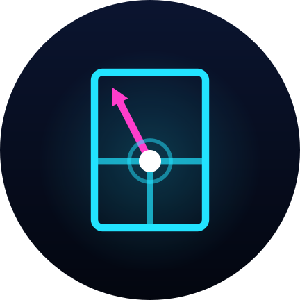
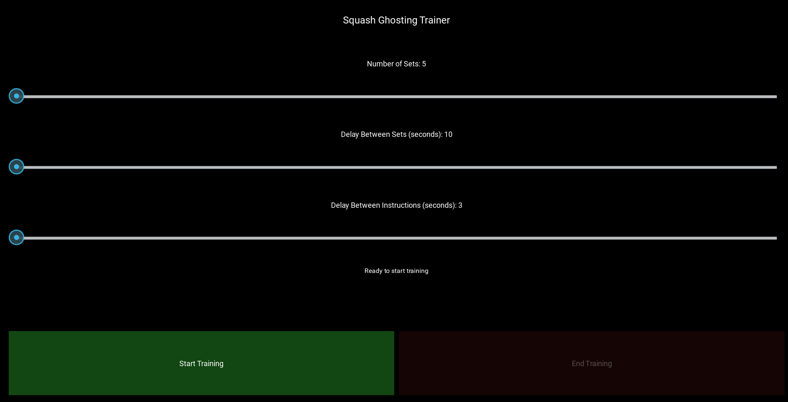

<!-- Squash Ghosting Project README -->

<h1 align="center">🏸 Squash Ghosting</h1>
<h3 align="center">AI-Powered Squash Training App | Voice-Guided Ghosting Practice | V1: Python/Kivy · V2: Native Android (Kotlin)</h3>

  
  
  
  
  

  
  
  
  

<h2>🎯 About Squash Ghosting</h2>

  <strong>Squash Ghosting</strong> is a revolutionary mobile application designed specifically for squash players who want to elevate their ghosting practice to professional levels. Transform your smartphone into a personal squash coach with precision timing, customizable training parameters, and crystal-clear voice guidance.

  Whether you're a beginner learning court movement patterns or an advanced player fine-tuning your positioning, this app eliminates guesswork from your practice routine, ensuring consistent intervals and allowing you to focus entirely on perfecting your technique.

<h2>📦 Versions</h2>

The repository contains two independent versions of the app, each in its own folder:

<table>
  <tr>
    <th></th>
    <th>🟦 V2 — Current</th>
    <th>⬜ V1 — Legacy</th>
  </tr>
  <tr>
    <td><b>Folder</b></td>
    <td><code>V2/SquashGhosting/</code></td>
    <td><code>V1/main.py</code></td>
  </tr>
  <tr>
    <td><b>Language / Framework</b></td>
    <td>Kotlin, Android Views + Material 3</td>
    <td>Python 3, Kivy 2.0</td>
  </tr>
  <tr>
    <td><b>Build</b></td>
    <td>Gradle in Android Studio</td>
    <td>Buildozer</td>
  </tr>
  <tr>
    <td><b>Platforms</b></td>
    <td>Android 8.0+ (API 26)</td>
    <td>Android, Windows, macOS, Linux</td>
  </tr>
  <tr>
    <td><b>Training Patterns</b></td>
    <td>5 drills (see below)</td>
    <td>One: all 6 positions shuffled each set</td>
  </tr>
  <tr>
    <td><b>Voice</b></td>
    <td>Choice of female or male coach voice</td>
    <td>System default voice</td>
  </tr>
  <tr>
    <td><b>Audio Cues</b></td>
    <td>3-second countdown beeps + beep at the start of each set</td>
    <td>Voice only</td>
  </tr>
  <tr>
    <td><b>Screen-off Training</b></td>
    <td>Screen stays on; calls continue if it turns off</td>
    <td>Not supported</td>
  </tr>
  <tr>
    <td><b>Status</b></td>
    <td>Actively developed</td>
    <td>Kept for reference; no new features</td>
  </tr>
</table>

<h3>🆕 What's New in V2</h3>
<ul>
  <li><strong>Rebuilt natively for Android</strong> in Kotlin, opened and run directly in Android Studio</li>
  <li><strong>5 training patterns:</strong> Front Two Corners, Backcourt / Service Box, Diagonal &amp; Half-Moon, Random / Rally and Star</li>
  <li><strong>Smarter sequences:</strong> drills are randomly mirrored, and a set never starts on the same corner the last one ended on</li>
  <li><strong>Female or male coach voice</strong>, picked from the best offline voice on the device, with a live preview</li>
  <li><strong>Countdown and set-start beeps</strong> so you know when to move without looking at the phone</li>
  <li><strong>Uninterrupted sessions:</strong> keeps the screen on, keeps calling if the screen turns off, and survives screen rotation</li>
  <li><strong>New futuristic app icon</strong> and a dark, court-at-night interface that fits every screen size</li>
</ul>

<h2>✨ Key Features</h2>
<table>
  <tr>
    <td align="center"></td>
    <td><b>Customizable Set Configuration:</b></td>
    <td>Choose exactly how many sets you want to complete in each training session <i>(V1 &amp; V2)</i></td>
  </tr>
  <tr>
    <td align="center"></td>
    <td><b>Precision Timing Control:</b></td>
    <td>Fine-tune delay between sets to match your fitness level and training intensity <i>(V1 &amp; V2)</i></td>
  </tr>
  <tr>
    <td align="center"></td>
    <td><b>Voice-Guided Instructions:</b></td>
    <td>Crystal-clear audio cues with customizable delay between spoken instructions <i>(V1 &amp; V2)</i></td>
  </tr>
  <tr>
    <td align="center"></td>
    <td><b>Structured Practice:</b></td>
    <td>Professional-grade training structure without external timers or coaches <i>(V1 &amp; V2)</i></td>
  </tr>
  <tr>
    <td align="center"></td>
    <td><b>Mobile Optimized:</b></td>
    <td>V2 is a native Kotlin Android app; V1 is built with Kivy for Android and desktop</td>
  </tr>
  <tr>
    <td align="center"></td>
    <td><b>Training Patterns:</b> 🆕</td>
    <td>Five drills targeting the front corners, the backcourt, diagonals or full-court rally movement <i>(V2 only)</i></td>
  </tr>
  <tr>
    <td align="center"></td>
    <td><b>Coach Voice Selection:</b> 🆕</td>
    <td>Switch between a female and male voice at any time, even mid-session <i>(V2 only)</i></td>
  </tr>
  <tr>
    <td align="center"></td>
    <td><b>Countdown &amp; Beeps:</b> 🆕</td>
    <td>A 3-second countdown and a distinct beep at the start of every set <i>(V2 only)</i></td>
  </tr>
</table>

<h2>🛠 Tech Stack</h2>

<h3>🟦 V2 — Native Android</h3>

  
  
  
  
  
  

<h3>⬜ V1 — Python / Kivy</h3>

  
  
  
  
  

<h3>🎮 User Interface</h3>

  
  

<h2>🚀 Quick Start</h2>

<h3>📱 For Users (APK Installation)</h3>

<h3>👨‍💻 For Developers</h3>

<h4>Clone the repository</h4>
git clone https://github.com/Samridh1607/SquashGhost.git

cd SquashGhost

<h4>🟦 V2 — Android Studio</h4>
1. Open the <code>V2/SquashGhosting</code> folder in Android Studio (Narwhal or newer)

2. Let Gradle sync, then run the <code>app</code> configuration on a device or emulator

<h4>Build APK (V2)</h4>
cd V2/SquashGhosting

gradlew assembleDebug

<h4>⬜ V1 — Install dependencies</h4>
pip install kivy==2.0.0

pip install buildozer

<h4>Run locally (V1)</h4>
cd V1

python main.py

<h4>Build APK (V1)</h4>
buildozer android debug

<h2>📋 How It Works</h2>

<table>
  <tr>
    <th>Step</th>
    <th>Action</th>
    <th>Description</th>
  </tr>
  <tr>
    <td align="center">1️⃣</td>
    <td><b>Configure</b></td>
    <td>Set number of sets, rest intervals, and instruction timing (V2: also pick a pattern and voice)</td>
  </tr>
  <tr>
    <td align="center">2️⃣</td>
    <td><b>Position</b></td>
    <td>Stand ready at center court with phone for clear audio (V2: wait for the 3-second countdown)</td>
  </tr>
  <tr>
    <td align="center">3️⃣</td>
    <td><b>Listen</b></td>
    <td>Follow precisely timed verbal movement instructions, recovering to the T after each one</td>
  </tr>
  <tr>
    <td align="center">4️⃣</td>
    <td><b>Execute</b></td>
    <td>Complete sets with automatic timing for movement and rest</td>
  </tr>
  <tr>
    <td align="center">5️⃣</td>
    <td><b>Progress</b></td>
    <td>Monitor improvement and gradually increase intensity</td>
  </tr>
</table>

<h2>🎯 Perfect For</h2>

<ul>
  <li><strong>🏆 Competitive Players:</strong> Maintain consistent training routines between matches</li>
  <li><strong>👨‍🏫 Coaches:</strong> Standardize ghosting drills for teams and individual students</li>
  <li><strong>💪 Fitness Enthusiasts:</strong> Use squash court movements for cardiovascular training</li>
  <li><strong>🔰 Beginners:</strong> Learn proper court movement patterns with guided instruction</li>
  <li><strong>🏃‍♂️ Solo Practitioners:</strong> Train independently without requiring a partner or coach</li>
</ul>

<h2>📸 Screenshots</h2>

<h3>🟦 V2 — App Icon</h3>

  

<h3>⬜ V1 — Main Interface</h3>

  

<h2>🔧 Configuration Options</h2>

<table>
  <tr>
    <th>Parameter</th>
    <th>Range</th>
    <th>Default</th>
    <th>Version</th>
    <th>Description</th>
  </tr>
  <tr>
    <td>Number of Sets</td>
    <td>5-15</td>
    <td>5</td>
    <td>V1 &amp; V2</td>
    <td>Total training sets per session</td>
  </tr>
  <tr>
    <td>Set Delay</td>
    <td>10-30s</td>
    <td>10s</td>
    <td>V1 &amp; V2</td>
    <td>Rest time between sets</td>
  </tr>
  <tr>
    <td>Instruction Delay</td>
    <td>3-5s</td>
    <td>3s</td>
    <td>V1 &amp; V2</td>
    <td>Time between voice commands (V2: adjustable during a session)</td>
  </tr>
  <tr>
    <td>Pattern 🆕</td>
    <td>5 drills</td>
    <td>Random / Rally</td>
    <td>V2 only</td>
    <td>Which court movements are called in each set</td>
  </tr>
  <tr>
    <td>Voice 🆕</td>
    <td>Female / Male</td>
    <td>Female</td>
    <td>V2 only</td>
    <td>Coach voice; can be changed mid-session</td>
  </tr>
</table>

<h3>🧭 V2 Training Patterns</h3>

<table>
  <tr>
    <th>Pattern</th>
    <th>Calls per Set</th>
    <th>Focus</th>
  </tr>
  <tr>
    <td>Front Two Corners</td>
    <td>6</td>
    <td>Alternates between the two front corners</td>
  </tr>
  <tr>
    <td>Backcourt / Service Box</td>
    <td>8</td>
    <td>Back corners mixed with the mid-court sides</td>
  </tr>
  <tr>
    <td>Diagonal &amp; Half-Moon</td>
    <td>8 / 6</td>
    <td>Alternates by set: diagonal corner-to-corner runs, then a half-moon arc around the court</td>
  </tr>
  <tr>
    <td>Random / Rally</td>
    <td>8</td>
    <td>Unpredictable, match-like sequence with no repeated calls back to back</td>
  </tr>
  <tr>
    <td>Star</td>
    <td>6</td>
    <td>Every position once per set, in random order</td>
  </tr>
</table>

<h2>🤝 Contributing</h2>

We welcome contributions from the squash community! New features go into <strong>V2</strong>; V1 is kept for reference. Here's how you can help:

<ul>
  <li>🐛 <strong>Bug Reports:</strong> Found an issue? Open an issue with details and say whether it's V1 or V2</li>
  <li>💡 <strong>Feature Requests:</strong> Have an idea? Let us know in discussions</li>
  <li>🔧 <strong>Code Contributions:</strong> Fork, develop, and submit pull requests</li>
  <li>📚 <strong>Documentation:</strong> Help improve our docs and tutorials</li>
  <li>🎨 <strong>UI/UX:</strong> Design improvements and user experience enhancements</li>
</ul>

